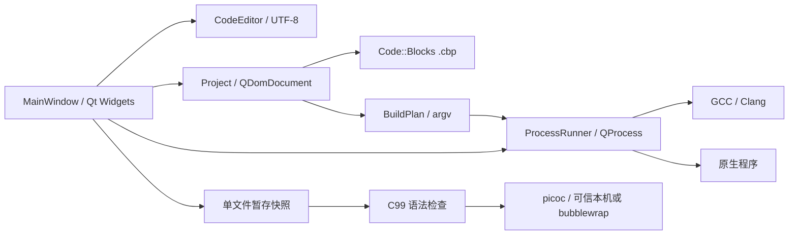

# 架构与实现边界

## 组件

UI 不拼接 shell 命令。QProcess 接收独立程序路径与参数列表，路径中的空格不会变成新的命令。日志逐个展示参数，仅供阅读，不作为 shell 命令重新执行。这不代表编译器自身参数是安全的：不要构建不可信 `.cbp`；插件、响应文件、编译器选项可能执行其他代码或写入指定位置。

## 数据与事务

加载时先验证临时 DOM，成功后替换当前模型。无效 XML 不破坏当前工程。拒绝超过 8 MiB 的工程文件以及含 DTD/实体声明的工程文件。

`Project` 保存完整 DOM，仅更改明确操作的节点，以保留 Code::Blocks 扩展配置。`QSaveFile` 提供文件级原子替换。新增/移除引用保存失败时回滚 DOM；移除工程引用不删除源文件。新建工程禁止覆盖已有目录，部分创建失败可能留下目录与 main.c，需用户检查后清理。

构建参数采用工程级与目标级配置顺序合并。原型尚不处理 Code::Blocks 的 compiler/linker options relation、逐文件自定义构建、PCH、构建权重、环境变量展开、extension_auto/prefix_auto 的全部组合，也不调用原 Code::Blocks 插件。保存兼容性不等于构建语义完全兼容。高级工程建议在原 Code::Blocks 中构建。

## 状态流

普通构建：Idle → Build → Idle。

构建并运行：Idle → Build → 成功后 Native → Idle；构建失败直接返回 Idle，不运行旧文件。

picoc：Idle → 创建临时目录与 main.c 快照 → 校验执行模式 → Check → 成功后 Picoc → Idle。临时目录在进程结束后释放。检查失败、启动失败、停止与超时均不进入下一阶段。

运行期间禁用工程修改和编辑，以明确当前执行代码版本。ProcessRunner 合并 stdout/stderr 并增量解码 UTF-8；输出到限后杀死进程并保留已收到内容。每个启动只产生一次 completed 信号，FailedToStart 与 finished 共享完成保护。

## 测试设计

核心测试覆盖：新建工程读写、未知 XML 保留、路径含空格、反斜杠规范化、重复添加、移除不删文件、坏文件加载回滚、目标文件归属、宏/自定义命令拒绝、C/C++ 混合目标拒绝。

ProcessRunner 使用独立 fixture 可执行程序验证实际进程成功/失败、启动失败、重启、标准输入、跨块 UTF-8、超时、主动停止、输出溢出与重复启动拒绝。GUI smoke test 用 Qt offscreen 插件检查主窗口构造和事件循环。

没有采用假 picoc 伪造解释执行；fixture 仅用于进程管理测试。picoc 真实集成验证与鸿蒙真机测试应单独记录。
